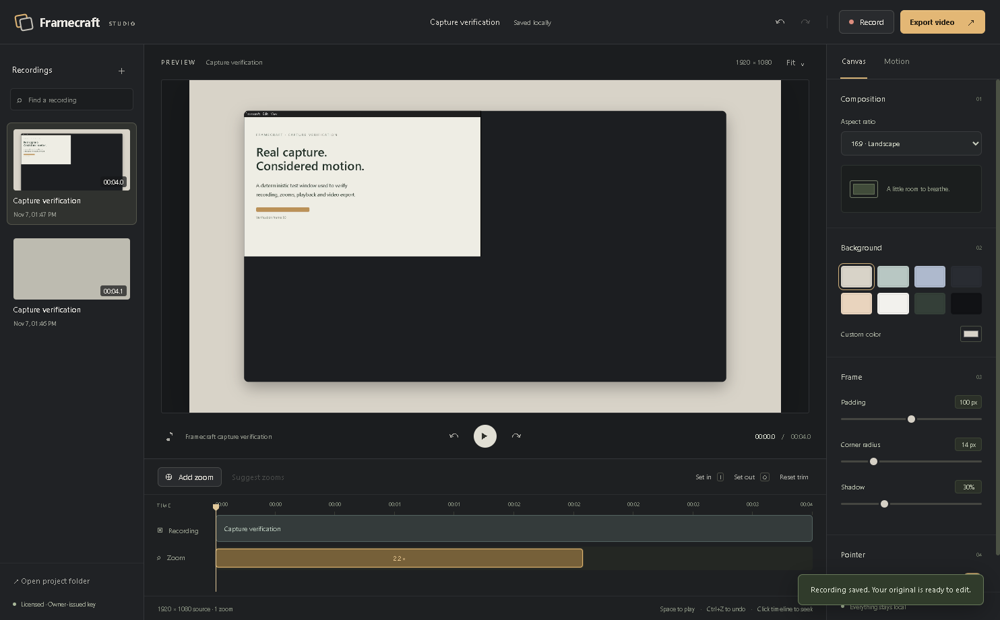

# Informent projects

Practical Windows software for creative work, local files, field work and community tools.

This is the public project catalog. Application source and owner distributions are private. Protected Windows builds require an owner-issued Keydock license.

| Project | Purpose |
| --- | --- |
| Informent Hub | A single home for project previews, verified updates and one-click launches. |
| Framecraft | Record a screen or window, trim footage, add focused zooms and export video. |
| UploadFit | Fit local video clips under a measured upload-size limit. |
| Keydock | Owner-controlled licensing, device limits, revocation and release signing. |
| HFC Field Tracker | Local equipment maps, field visits, review and marked PDF exports. |
| HFC Setup Assistant | HFC meter checks and supplied Pilot setup references. |
| Packbench | Windows application packaging and release preparation. |
| Rackwatch | Local server operations and monitoring tools. |
| Backstop | Verified file backup snapshots and restore previews. |
| Cliptray | Local clipboard management. |
| Batchwork | Batch renaming with collision checks and rollback. |
| Footprint | Disk usage inspection. |
| Savepoint | PC game save backups and restoration. |
| Checkup | Read-only Windows health checks. |
| Courier | Local file transfer tools. |
| Guildkit | Discord message drafts, timestamps and game-night planning. |
| Latch | Discord moderation and community workflows. |

## Framecraft

## Owner downloads

The owner can download [Informent Hub](https://github.com/informent/Informent-Hub/releases/latest) from its private release page. The Hub discovers owner-signed releases, verifies downloaded executables, and keeps installed projects current. These downloads require repository access and application licenses.

Earlier publicly distributed versions retain their original licenses. Current private distribution does not revoke rights already granted for those versions.
